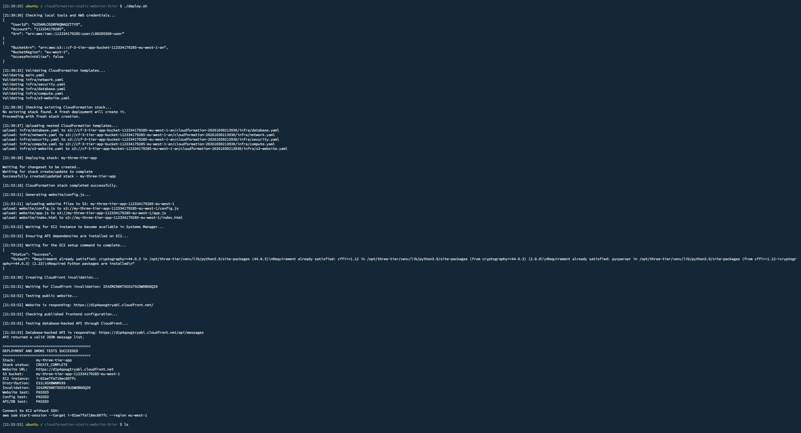
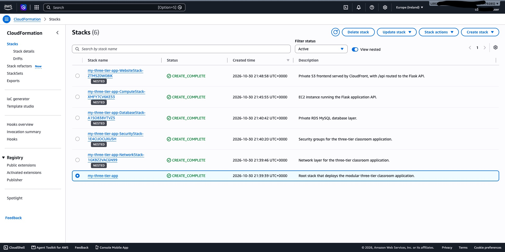
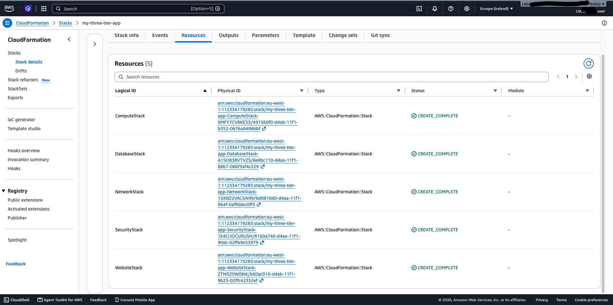
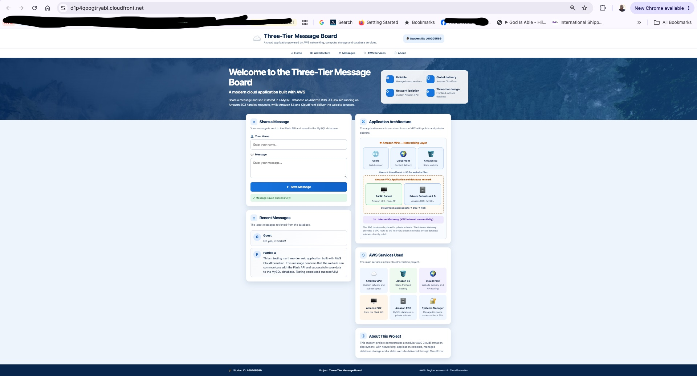

# CloudFormation Lab: Static Website and Three-Tier Architecture

**Student Name:** Patrick Affadu  
**Student ID:** L00205569  
**Module:** CloudFormation Lab  
**AWS Region:** `eu-west-1`

## 1. Project Overview

This project demonstrates how to use AWS CloudFormation to create and deploy a static website and a three-tier web application.

The website allows users to submit and view messages. The website files are stored in Amazon S3 and delivered through CloudFront. An Amazon EC2 instance runs the Python Flask API, while Amazon RDS for MySQL stores the messages.

I used CloudFormation templates to create the AWS infrastructure and a Bash script to automate deployment and testing.

### Project Objectives

- Create a static website using AWS CloudFormation.
- Store website files in Amazon S3.
- Use CloudFront to make the website publicly accessible.
- Build a three-tier application using AWS services.
- Automate infrastructure deployment.
- Apply basic security and networking practices.
- Test the website, API and database connection.

## 2. Assignment Requirements

| Requirement | Implementation |
|---|---|
| Create a website using CloudFormation | `infra/s3-website.yaml` |
| Display student name and ID | Website header |
| Store website files | Amazon S3 |
| Provide public website access | Amazon CloudFront |
| Implement three-tier architecture | Network, compute, security and database templates |
| Use Infrastructure as Code | CloudFormation YAML templates |
| Automate deployment | `deploy.sh` |
| Apply good coding practices | Modular templates, parameters and outputs |
| Test the application | Deployment and application checks |
| Demonstrate version control | GitHub commits and pull requests |

## 3. Technologies and Why I Used Them

### AWS CloudFormation

I used CloudFormation to create and manage AWS resources through YAML files instead of creating everything manually in the AWS Console.

It makes deployment repeatable and easier to manage.

### Amazon S3

I used S3 to store the website files, including HTML and JavaScript. It provides a simple and reliable way to store static website content.

### Amazon CloudFront

I used CloudFront to deliver the website to users through a public URL. It also caches website content, helping pages load faster.

### Amazon EC2

I used EC2 to host the Python Flask API. The API handles requests from the website and communicates with the database.

### Amazon RDS for MySQL

I used RDS to store submitted messages. This means the messages remain available even when the user refreshes the website.

### Amazon VPC

I used a VPC to create a private network for the application. It allows me to control how the different AWS resources communicate.

### Security Groups

I used security groups to control network traffic between resources. For example, the database only accepts connections from authorised application resources.

### AWS Systems Manager

I used Systems Manager to manage the EC2 instance and run commands without needing direct SSH access.

### AWS Secrets Manager

I used Secrets Manager to securely store and manage the database password. The application can retrieve the password when needed without keeping it directly in the CloudFormation templates or application code.

This helps protect sensitive information and makes password management easier.

### Bash

I used Bash to write `deploy.sh`, which automates deployment and performs checks after deployment.

### Git and GitHub

I used Git to track changes to the project and GitHub to store the repository and maintain the development history.

## 4. System Architecture

The application has three main tiers.

### 4.1 Web Tier

The web tier is the part users interact with.

I used Amazon S3 to store the website files and CloudFront to deliver them to users.

The frontend contains:

- `index.html` - Displays the website.
- `app.js` - Handles user interactions and API requests.
- `config.js` - Contains the API configuration used by the website.

### 4.2 Application Tier

The application tier runs on an Amazon EC2 instance.

I used Python Flask to build the API. It receives requests from the website, processes them and communicates with the database.

The API has three main endpoints:

| Endpoint | Method | Purpose |
|---|---|---|
| `/health` | GET | Checks whether the API is running |
| `/api/messages` | GET | Retrieves messages from the database |
| `/api/messages` | POST | Saves a new message |

### 4.3 Database Tier

I used Amazon RDS for MySQL to store the messages submitted through the website.

Keeping the database separate from the application makes the solution easier to manage and allows the application to access stored information when needed.

The database password is stored in AWS Secrets Manager rather than directly in the application code.

### 4.4 How the Application Works

1. A user opens the website through CloudFront.
2. CloudFront retrieves the website files from S3.
3. The user submits a message through the website.
4. The website sends the request to the Flask API running on EC2.
5. The API retrieves the database credentials from Secrets Manager and saves the message in RDS MySQL.
6. The API returns the response to the website.

## 5. Repository Structure

```text
.
├── CODE_OF_CONDUCT.md
├── deploy.sh
├── infra/
│   ├── compute.yaml
│   ├── database.yaml
│   ├── network.yaml
│   ├── s3-website.yaml
│   └── security.yaml
├── main.yaml
├── README.md
├── screenshot/
│   ├── cloudformation-nested-stacks.jpg
│   ├── cloudformation-stack-overview.jpg
│   ├── deploy.sh-deployment-success.jpg
│   └── webapp-test-page.jpg
└── website/
    ├── app.js
    ├── config.js
    └── index.html
```

### What the Files and Folders Do

| File/Folder | Purpose |
|---|---|
| `main.yaml` | Main template that brings the other CloudFormation templates together |
| `infra/network.yaml` | Creates the VPC and networking resources |
| `infra/security.yaml` | Creates security groups and controls network access |
| `infra/compute.yaml` | Creates the EC2 application server |
| `infra/database.yaml` | Creates the MySQL database and related resources |
| `infra/s3-website.yaml` | Creates the S3 website bucket and CloudFront resources |
| `website/` | Contains the frontend website files |
| `screenshot/` | Contains screenshots showing deployment, CloudFormation stacks and website testing |
| `deploy.sh` | Main script for automating deployment and testing |
| `deploy_fixed.sh` | Contains the corrected deployment script |
| `README.md` | Documents the project, architecture and deployment process |

## 6. CloudFormation Design

I divided the infrastructure into smaller templates using nested stacks.

The main template, `main.yaml`, connects and deploys the individual templates.

I used this approach to keep the project organised. It also makes it easier to understand, update and troubleshoot individual parts of the infrastructure.

## 7. Deployment Automation

I created `deploy.sh` to automate the deployment process instead of running every command manually.

The script:

1. Checks the required tools and configuration.
2. Validates the CloudFormation templates.
3. Uploads nested templates to S3.
4. Creates or updates the CloudFormation stack.
5. Publishes the website files.
6. Checks the EC2 instance using Systems Manager.
7. Tests the website and API.

This makes deployment easier and reduces the chances of missing a step.

## 8. Prerequisites

Before deployment, the following are required:

- An AWS account with the necessary permissions.
- AWS CLI installed and configured.
- Bash and `curl`.
- An S3 bucket for storing nested CloudFormation templates.
- The project files and required deployment parameters.

AWS credentials and passwords should never be committed to GitHub.

## 9. Deployment

Clone the repository:

```bash
git clone https://github.com/L00205569/cloudformation-static-website-3tier.git

cd cloudformation-static-website-3tier
```

Validate the main CloudFormation template:

```bash
aws cloudformation validate-template \
  --template-body file://main.yaml \
  --region eu-west-1
```

Make the deployment script executable and run it:

```bash
chmod +x deploy.sh
./deploy.sh
```

After deployment, open the CloudFront URL provided by the script.

Submit a message through the website and refresh the page to check that the message is retrieved from the database.

## 10. Testing

I included checks in the deployment script to confirm that the infrastructure and application are working.

The following tests were completed after running `deploy.sh` successfully on 30 October 2026.

| Test | Result |
|---|---|
| CloudFormation template validation | Pass |
| CloudFormation deployment | Pass |
| Website availability | Pass |
| Frontend configuration | Pass |
| API and database integration | Pass |

### 10.1 Deployment Evidence

The following screenshots provide evidence of the successful deployment and testing.

**Successful Deployment**

The screenshot shows the output from `deploy.sh`, confirming that the CloudFormation deployment completed and the website, configuration and API/database smoke tests passed.



**CloudFormation Stack Overview**

The screenshot shows the root CloudFormation stack, `my-three-tier-app`, and its five nested stacks. All six stacks were created successfully with a `CREATE_COMPLETE` status.



**CloudFormation Nested Stack Resources**

The screenshot shows the five nested stacks created under the root stack, all with a `CREATE_COMPLETE` status.



### 10.2 Website and Application Testing

The screenshot below shows the deployed Three-Tier Message Board working successfully.

I submitted a test message through the website and confirmed that it was saved successfully and displayed under Recent Messages.

This verifies that:

- The website is accessible through CloudFront.
- The frontend can communicate with the Flask API.
- The API can process and save submitted messages.
- The MySQL database stores the messages.
- Previously submitted messages can be retrieved and displayed on the website.



## 11. Deployment Issues and Fixes

During development, I encountered some issues and made changes to resolve them.

1. **CloudFormation stack name conflict:** The script initially used a different stack name. I updated it to use `my-three-tier-app` so that deployments consistently use the intended root stack name.

2. **Existing S3 bucket conflict:** CloudFormation attempted to create a bucket that already existed. I adjusted the deployment approach to avoid creating a duplicate bucket.

3. **Nested template uploads:** I updated the upload process to use timestamped S3 prefixes. This helps prevent conflicts with previously uploaded templates.

4. **CloudFormation parameters:** I corrected the parameters passed between the main template and nested stacks, including the configuration used for AWS Systems Manager Parameter Store.

5. **Database password management:** Initially, I used AWS Systems Manager Parameter Store to store the database password. However, I encountered limitations when using the SecureString parameter with the database configuration in CloudFormation. I moved the database password to AWS Secrets Manager because it is designed for securely storing sensitive information such as database credentials. This also makes it easier for the application to retrieve the password without exposing it in the project files.

6. **API HTTP 500 errors:** The API was failing because a required Python dependency, `cryptography`, was missing. I added it to the EC2 installation process.

7. **Deployment validation:** I improved the checks in the deployment script to verify the templates, configuration, EC2 instance, website and API.

8. **CloudFront caching:** I added CloudFront cache invalidation to the deployment process so that updated website files can be delivered without waiting for old cached content to expire.

9. **S3 bucket and stack deletion:** I discovered that the S3 website bucket must be emptied before CloudFormation can delete the stack if the bucket contains objects. Otherwise, stack deletion can fail because CloudFormation cannot delete a non-empty bucket. I use the following commands to empty the website bucket and delete the root stack:

```bash
aws s3 rm s3://student-three-tier-112334179285-eu-west-1 \
  --recursive \
  --region eu-west-1

aws cloudformation delete-stack \
  --stack-name my-three-tier-app \
  --region eu-west-1
```

After making these changes, the deployment completed successfully and the website, API and database checks passed.

## 12. Limitations and Future Improvements

The application is currently deployed in my AWS account for this assignment.

There are several areas I could improve in the future:

- Add a load balancer and Auto Scaling to handle increased traffic.
- Introduce more automated application tests.
- Set up monitoring and alerts.
- Improve backup and recovery procedures.

These improvements would make the application more suitable for a production environment.

## 13. Development and Version Control

I used Git and GitHub to manage the project.

The repository contains the development history through commits, feature branches and pull requests. This makes it easier to track changes and understand how the project developed.

GitHub repository:

https://github.com/L00205569/cloudformation-static-website-3tier

## 14. Research and AI Assistance

### AWS Documentation

I referred to AWS documentation to understand CloudFormation and how it is used to create AWS infrastructure.

Reference:

https://docs.aws.amazon.com/AWSCloudFormation/latest/UserGuide/Welcome.html

### AI Assistance

I used an AI assistant during development to help me understand CloudFormation concepts, troubleshoot errors and review my deployment script.

Some of the areas where I received assistance included:

- Understanding nested CloudFormation stacks.
- Troubleshooting deployment errors.
- Reviewing the deployment script.
- Understanding AWS networking and security.
- Improving the project documentation.

I reviewed and tested the suggested changes as part of the development process.

## 15. Conclusion

This project helped me understand how to use AWS CloudFormation to create and manage cloud infrastructure.

I used S3 and CloudFront to deliver the website, EC2 to host the Flask API, and RDS to store application data. I also used Secrets Manager to protect the database password.

I gained practical experience with nested CloudFormation stacks, AWS networking, security groups, deployment automation and testing.

Overall, the project demonstrates how different AWS services can work together to build and deploy a simple web application.
